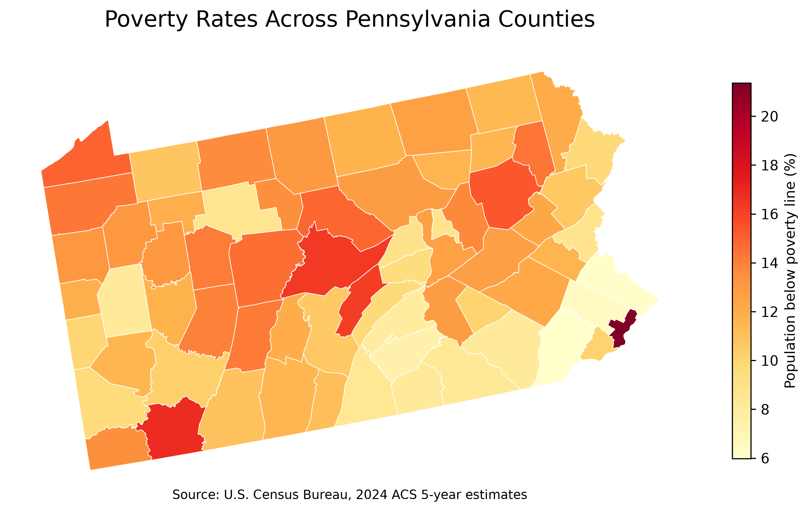
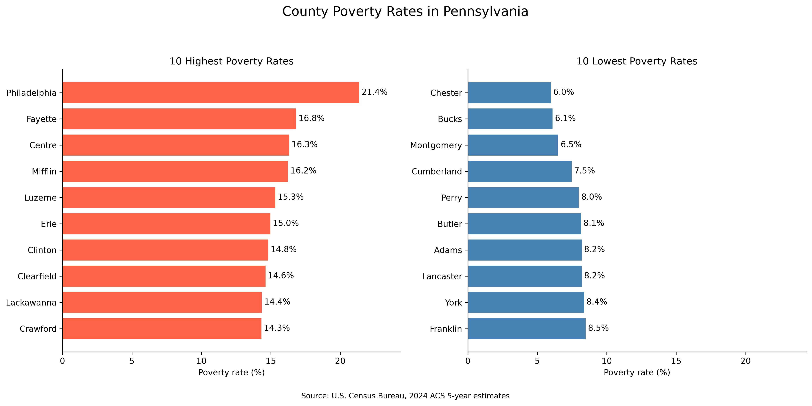

## Why I looked at this

Pennsylvania has two big cities, a ring of wealthy suburbs, and a lot of small towns and farmland in between. I wanted to see which of the state's 67 counties have the highest poverty rates, and in particular whether poverty here is mostly a big-city thing.

## Data

I used the 2024 American Community Survey (ACS) 5-year estimates, which pool survey responses from 2020 to 2024. The 1-year estimates only cover counties with at least 65,000 people, so the 5-year version is the only way to get numbers for every county. The trade-off is that these numbers describe the whole 2020–2024 period, not 2024 by itself.

From ACS table B17001 I pulled two variables:

- `B17001_001E`: people whose poverty status is determined
- `B17001_002E`: people below the poverty line

The poverty rate is just the second divided by the first, times 100.

I got the data from the Census API and joined it to the Census Bureau's county boundary file on GEOID. All 67 counties matched. The map and bar chart were made with GeoPandas and Matplotlib.

## The map

{width="100%"}

*Figure 1. County-level poverty rates in Pennsylvania.*

Philadelphia stands out right away at 21.4%. The suburban counties next to it look completely different: Chester, Bucks, and Montgomery are all under 7%.

But Philadelphia isn't the only dark spot. Several counties in central and western Pennsylvania also have fairly high rates, and there's no clean east-west split. Neighboring counties often end up with quite different numbers.

## Highest and lowest counties

{width="100%"}

*Figure 2. The ten highest and ten lowest county poverty rates in Pennsylvania.*

At the top are Philadelphia (21.4%), Fayette (16.8%), Centre (16.3%), and Mifflin (16.2%). At the bottom are Chester (6.0%), Bucks (6.1%), and Montgomery (6.5%).

The gap between Philadelphia and Chester County is 15.4 percentage points. Philadelphia's rate is more than three times Chester's, and the two are part of the same metro area.

Centre County comes with a caveat. It's home to Penn State, and college students living off campus usually report little income, which probably pushes the county's rate up. So a high number there doesn't mean the same thing as a high number in Fayette.

Put together, the rankings don't fit a simple "poor rural, rich urban" story. The poorest county is the state's biggest city, the least poor are its own suburbs, and smaller counties like Fayette and Mifflin are near the top too.

## What's behind the differences?

I can't answer that with this data. Industry mix, access to jobs, housing costs, and who lives where all likely play a role. Philadelphia and its suburbs share one regional job market but have very different poverty rates, which makes me suspect that where people live matters as much as where the jobs are. That's a guess, though. Testing it would take data on employment, education, demographics, and housing.

It's also worth remembering that each county gets a single number. A county with a low overall rate can still have neighborhoods where poverty is common, and not every part of a high-poverty county is equally affected. Tract-level data would show much more of that variation.

## Wrapping up

Poverty in Pennsylvania doesn't split neatly into urban and rural. Philadelphia has the highest rate, its suburbs have the lowest, and several smaller counties farther west rank high as well. The part I didn't expect was how big the gaps are between counties that sit right next to each other, especially in the southeast corner of the state. I'd like to come back to this with tract-level data to see what's happening inside these counties.

## Data Sources and Code

- [U.S. Census Bureau — American Community Survey](https://www.census.gov/programs-surveys/acs)
- [2024 ACS 5-Year Estimates — Poverty Status Table B17001](https://api.census.gov/data/2024/acs/acs5/groups/B17001.html)
- [U.S. Census Bureau — 2024 County Boundary Files](https://www2.census.gov/geo/tiger/GENZ2024/shp/cb_2024_us_county_500k.zip)

The analysis was done in Python using Pandas, GeoPandas, Requests, and Matplotlib. The data cleaning, county matching, and figures can be reproduced with [`python/blog_post5_analysis.py`](https://github.com/Erikn2788/EricLu-website/blob/main/python/blog_post5_analysis.py) in my GitHub repo. You'll need a free Census API key to pull the data.