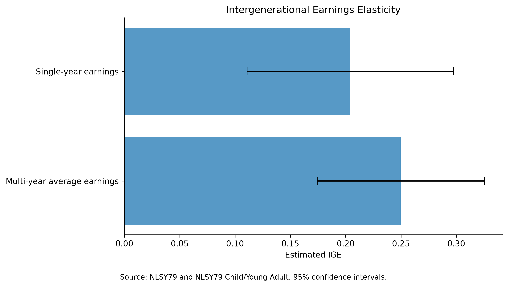
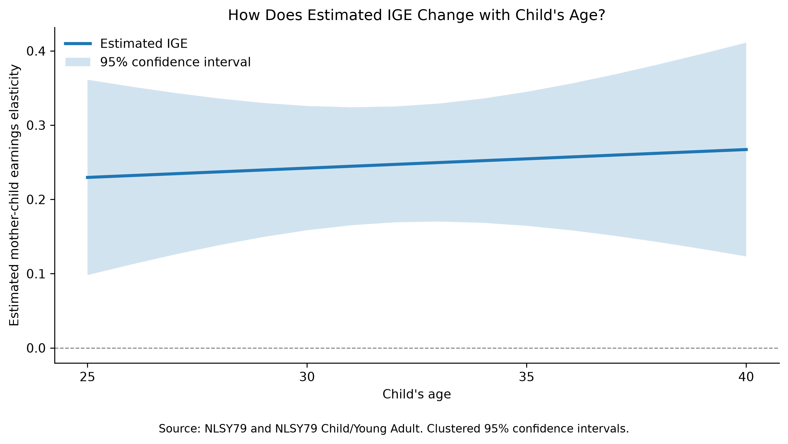

## Why I did this

If you know how much a mother earns, how much does that tell you about what her children will earn as adults?

Economists call this intergenerational income mobility. I wanted to measure it myself with longitudinal data, which follow the same people over many years.

The tricky part was linking mothers and children across two datasets. I used SQL to match them and then estimated the intergenerational earnings elasticity (IGE). I also wanted to see whether using several years of earnings instead of one would change the answer.

## Data

I used two National Longitudinal Surveys:

- **NLSY79**, which has followed a group of Americans since 1979.
- **NLSY79 Child and Young Adult (NLSCYA)**, which follows the biological children of the women in NLSY79.

Each child record includes the mother's ID, so the two datasets can be linked.

For mothers, I used wage and salary earnings from the 1998, 2000, 2002, and 2004 surveys. For children, I used 2012, 2014, 2016, 2018, and 2020. The earnings usually refer to the year before the survey, so I converted them to 2024 dollars using that year's CPI-U.

For the main analysis, I only used earnings between ages 30 and 40, and both mother and child needed at least two years of positive earnings.

## Matching mothers and children with SQL

The original datasets have thousands of variables. In Python, I kept just the IDs, ages, and earnings, then reshaped the data so each row is one person in one survey year.

I loaded the records into SQLite as two tables: `mother_income` and `child_income`.

### Step 1: Link the IDs

First, I matched children to their mothers with an `INNER JOIN`:

```sql
SELECT DISTINCT
    c.child_id,
    c.mother_id
FROM child_income AS c
INNER JOIN mother_income AS m
    ON c.mother_id = m.mother_id;
```

`JOIN` connects the two tables on mother ID, and `DISTINCT` removes the duplicate pairs that come from having several survey years per person.

This first match covered 11,551 children, though many of them didn't have enough valid earnings to use.

### Step 2: Calculate average earnings

Next, I used `GROUP BY` and `AVG()` to get each person's average earnings.

Here's a simplified version of the query for mothers:

```sql
SELECT
    m.mother_id,
    AVG(m.earnings * (313.689 / p.cpi)) AS average_earnings
FROM mother_income AS m
JOIN cpi AS p
    ON m.year - 1 = p.income_year
WHERE m.age BETWEEN 30 AND 40
  AND m.earnings > 0
GROUP BY m.mother_id
HAVING COUNT(*) >= 2;
```

The CPI join puts earnings in 2024 dollars. `GROUP BY` groups each mother's records, and `HAVING` keeps only mothers with at least two valid years.

I ran the same steps for children and joined the two results. The final sample has **789 mother-child pairs from 620 mothers**.

## Estimating the IGE

I regressed the child's log earnings on the mother's log earnings:

$$
\ln(Y_{\text{child}}) = \alpha + \beta \ln(Y_{\text{mother}}) + \varepsilon
$$

$\beta$ is the IGE. An IGE of 0.25 means mothers who earn 1% more tend to have children who earn about 0.25% more.

I ran this twice on the same 789 pairs, once with single-year earnings and once with multi-year averages, clustering standard errors by mother.

{width="100%"}

*Figure 1. Estimated IGE using single-year and multi-year average earnings. Error bars show 95% confidence intervals.*

Using each person's most recent valid year, the **IGE is 0.204**. Using the average across several years, it goes up to **0.250**, about 22% higher.

Any single year might be unusual because of a job change, a stretch of unemployment, or a bonus. That kind of noise in mothers' earnings would push the IGE toward zero, and averaging several years should reduce it.

I haven't formally tested whether the two estimates are significantly different, though, so I can't say measurement error accounts for the whole gap.

## Does the child's age matter?

The other concern is **life-cycle bias**. Earnings change with age, so measuring children's earnings early in their careers could give a different estimate.

To check, I used 2,151 child-year observations from the same 789 children and let the IGE vary with age, controlling for survey year.

{width="100%"}

*Figure 2. Model-implied IGE across ages 25–40, with 95% confidence intervals.*

The IGE rises a little, from **0.230 at age 25** to **0.267 at age 40**.

But the age interaction is **not statistically significant (p = 0.746)**. The confidence intervals are wide, and there are only four observations at age 40. The line also assumes a straight-line relationship with age instead of estimating the IGE separately at each age.

So in this sample, I didn't find significant evidence that the IGE changes with age.

## Takeaways

Averaging earnings over several years gave a higher IGE than using a single year. How you measure earnings can change what you conclude about mobility.

SQL was what made the linking work: it connected mothers and children and collapsed their repeated earnings records before I ran any regressions.

A few caveats. The sample is only mothers and their biological children, and requiring positive earnings affects who ends up in it. And these are associations, not causal effects.

The thing I'll remember most is how much of the work was in matching and preparing the data, not in the final regression.

## Data Sources and Code

- [NLSY79](https://www.nlsinfo.org/content/cohorts/nlsy79)
- [NLSY79 Child and Young Adult](https://www.nlsinfo.org/content/cohorts/nlsy79-children)
- [BLS Consumer Price Index](https://www.bls.gov/cpi/)

The analysis uses Python, SQLite, Pandas, Statsmodels, and Matplotlib.

- `python/blog_post6_download.py` downloads the original NLS data.
- `python/blog_post6_analysis.py` prepares the data, does the SQL matching, estimates the IGE, and makes both figures.

The individual-level NLS data are not included in the public repo.